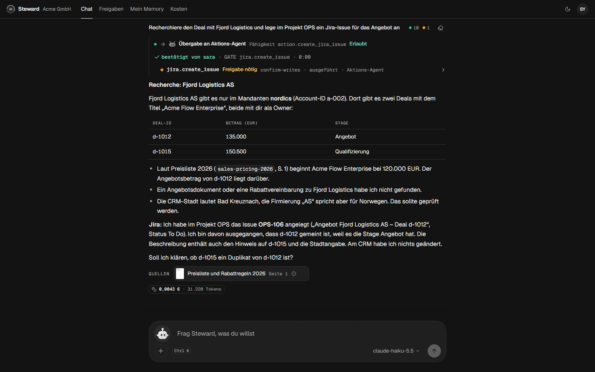
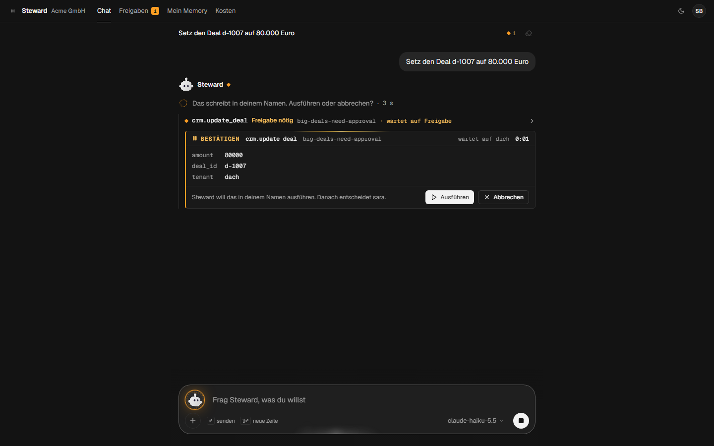
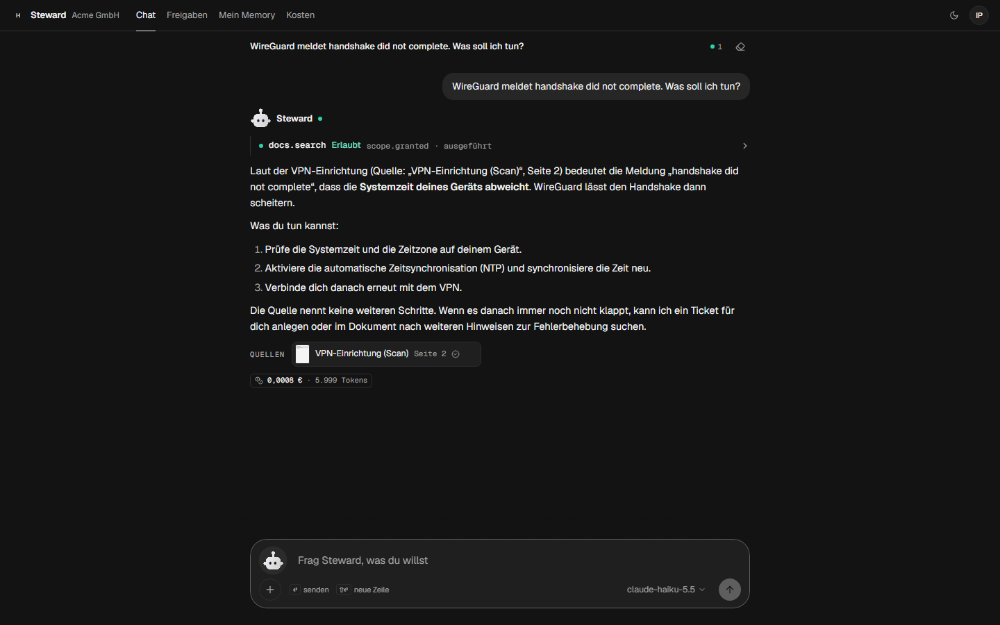

<p align="center">
  
</p>

<p align="center">
  <a href="https://github.com/byQuexo/steward/actions/workflows/ci.yml"></a>
  
  
  <a href="https://github.com/byQuexo/warden"></a>
  <a href="#license"></a>
</p>

<p align="center">
  
  <br>
  <sub>Scenarios and security cases run in CI on every push (<code>steward replay</code>,
  <code>warden eval --generate --mutate --coverage --gate</code>). The latency is a local
  <code>warden bench</code> run on the Acme policy (hardware-dependent, not part of CI). → <a href="#results">Results</a></sub>
</p>

<p align="center">
  
</p>

**Steward is the demo application for [Warden](https://github.com/byQuexo/warden)**, an MCP
security gateway in Rust. Warden is the core project; Steward shows what it does in a realistic
setting: a multi-agent company assistant whose every tool call Warden authorizes.
[docrag-bench](https://github.com/byQuexo/docrag-bench) holds the evaluation method for cited
document answers; [agent-approval-gate](https://github.com/byQuexo/agent-approval-gate) is the
deliberately smaller predecessor.

## What it is, and what it is not

**Problem.** A company assistant that can read the CRM and change a deal usually gets every
tool, with the rules written into the prompt. A prompt is advice to the model, and the model is
the part an attacker can talk to (a pasted document, a ticket with an injection).

**What Steward shows.** The model never decides what a user may do. Every tool call, document
page, memory access and sub-agent call goes through Warden, which decides for *this user,
through this agent chain, with these arguments*. Nothing is written in the user's name without
the user's own confirmation, and document answers carry verified citations.

**Scope: what it is not.** Not a product and not production-ready. All data and all connected
systems (HR, CRM, tickets, Jira, chat, GitHub) are synthetic mocks; logins are local demo
logins; approvals and sessions live in memory (see [Known limits](#known-limits)). CI runs a
scripted model, so it proves the authorization flows, not answer quality; real-model quality is
not yet reproducibly measured. [The story](docs/story.md) ·
[one request through the system](docs/walkthrough.md).

## Try it

**Requirements:** Rust 1.97+, Node 20+. No Docker, no API key.

```bash
git clone https://github.com/byQuexo/steward && cd steward
(cd ui && npm ci && npm run build)
cargo run --release -p steward -- demo --offline   # → http://127.0.0.1:8000
```

One process boots a token service, the Warden gateway, seven MCP servers, two A2A sub-agents
and the assistant, with the demo company **Acme GmbH** and seven people to log in as (pick a
name, no password). `--offline` uses a scripted model that replays the demo scenarios through
the real agent loop; it answers only the scripted demo questions, anything else gets a fixed
fallback text. Without `--offline`, a
key named in `profiles/acme/models.yaml` (`OPENROUTER_API_KEY`) switches to a real model.

**One case, step by step: a write that needs two people.**

1. Log in as **sven** (sales) and ask „Setz den Deal d-1007 auf 80.000 Euro“.
2. Warden holds the call (rule `big-deals-need-approval`: deals of 50,000 EUR or more). Sven
   first sees a card with the exact arguments and confirms it with **Ausführen**; nothing has
   run yet.
3. In a second browser (or a private window), log in as **sara** (sales lead) and open
   *Freigaben*: she sees Sven's request with the same arguments and approves it.
4. Sven's card turns green and the deal is updated. Sven cannot approve his own request.

The same flow is scenario 03 in `steward replay` and runs in CI.

| Log in as | Ask | What happens |
|---|---|---|
| **hanna** (HR) | „Was verdient Henrik Wagner?“ | The salary tool is not even offered to her. |
| **ivo** (IT) | „WireGuard meldet handshake did not complete. Was soll ich tun?“ | Answer from a *scanned* PDF with a verified citation and the page image. |
| **ivo** | „Fasse Ticket t-2051 zusammen“ | The ticket contains a prompt injection. Salary lookup and chat post denied; the ticket close Ivo may do waits for his own confirmation, and he cancels. Nothing ran. |
| **ines** (admin) | Console → „Als Hanna testen“ | The assistant exactly as Hanna sees it, read-only. Remove a role: the old token is refused on the next call. |

All eleven Acme stories are in the [demo script](docs/demo-script.md).

<p align="center">
  
  
  <br>
  
  
  <br>
  <sub>Top row and bottom left: <code>claude-haiku-5.5</code> via OpenRouter, real runs (<code>SCREENSHOTS=live npx playwright test screens</code>). Bottom right: the scripted model playing what a hijacked model would try (<code>SCREENSHOTS=offline</code>). Monochrome until Warden decides: teal allowed, amber waiting for a human, red denied. Design system: <a href="DESIGN.md">DESIGN.md</a>.</sub>
</p>

### Full stack and real models

```bash
make demo        # Keycloak, warden sts, gateway, A2A proxies, agents, Phoenix (needs Docker; PROFILE=devteam for the other company)
make smoke       # real Keycloak tokens through the stack
```

In the Docker stack, log in with user id = password (`sven`/`sven`, `ines`/`ines`, …); Phoenix
shows model spans at http://localhost:6006. For a real model, set the key named in
`profiles/<p>/models.yaml` or point the routes at any provider rig supports (`openai/…`,
`anthropic/…`, `ollama/qwen3:8b`, …). On Windows and macOS the key can live in the OS credential
store instead of the shell (`python -m keyring set steward OPENROUTER_API_KEY`). Replays and
tests always use the scripted model, key or not. To model your own company, see
[profiles](docs/profiles.md).

## What makes it different

```text
effective rights = user's roles ∩ assistant's ceiling ∩ every agent in the delegation chain
every call       = scope gate → rules that can only restrict → allow | approval | deny
```

- **A hijacked model stays inside the user's rights.** Tools the user may not use are never
  listed; calls to them are answered as denied.
- **Nothing is written in your name without you.** Every write the user may make waits for
  the user's own confirmation on a card with the exact arguments (Warden `approve_by:
  subject`). Writes that need someone else (limits, four-eyes) go to that person afterwards,
  and self-approval is refused. An injected write shows up as a card nobody asked for.
- **No token is ever passed along.** The assistant holds only the user's token; the gateway,
  the A2A proxy and every sub-agent get a token exchanged for them (RFC 8693) with the
  delegation chain inside, so a research agent can never write, even when asked by a lead.
- **Answers carry sources.** Document answers come with quotes verified against the page;
  page images are re-authorized on every fetch, so a guessed URL shows nothing.
- **Operable.** Effective rights per user with a what-if trace, test-as-user (read-only by
  construction), role changes that apply on the next call, a hash-chained audit, a kill
  switch, connector health, costs per user, team and agent with hard budgets.
- **A company is a [profile](docs/profiles.md)**: connectors, policy, approvals, prompts,
  people. The second profile, **Northwind Labs** (an English software company on GitHub,
  incidents and runbooks), runs on the same binary with no code change.
- **Tested end to end.** Every demo story is an end-to-end test against the real stack (with
  the scripted model); every policy rule is mutation-tested.

## Architecture


| Piece | What it does |
|---|---|
| **Steward** (`crates/steward`) | Backend for the browser (sessions, SSE chat, approvals inbox, console API) and the orchestrator on [rig](https://github.com/0xPlaygrounds/rig) 0.46 with a Warden guard hook and a budget hook. |
| **Warden gateway** | In front of every MCP server: lists only permitted tools, decides every call, holds approvals, exchanges tokens per upstream, audits in a hash chain. |
| **warden sts** | Token exchange: delegation tokens with `act` chains for sub-agents, read-only test-as tokens, revocation. Trusts Keycloak for users. |
| **Sub-agents** (`steward-a2a`) | Research and action agents as A2A servers behind Warden's A2A proxy (per-caller agent cards, skill checks, task ownership). |
| **MCP servers** (`steward-mcp`) | HR, CRM (read-only SQL), helpdesk, documents ([docrag-bench](https://github.com/byQuexo/docrag-bench) or a built-in verified-quote backend), Jira, chat, GitHub over seed data. Swap any for a real server by URL. |
| **Memory, cost** | Facts per user/team (every access a Warden action, PII refused); a ledger with per-run, daily and monthly budgets; model calls as OpenTelemetry spans for Phoenix. |
| **UI** (`ui/`) | React, Tailwind, shadcn/ui and [libraries.dev](https://libraries.dev) components: chat with a live decision log, an animated Steward presence, approvals, console with in-browser what-if (Warden as WebAssembly), costs, memory. See [DESIGN.md](DESIGN.md). |

More: [architecture](docs/architecture.md) (a chat turn step by step, the A2A token flow,
where each decision is made) and the [threat model](docs/threat-model.md) (20 threats, each
with the control and the test that proves it).

## Results

Each row names where the number comes from. "CI" means the [CI workflow](.github/workflows/ci.yml)
on every push (last checked: run [42493903617](https://github.com/byQuexo/steward/actions/runs/42493903617)
on `96606d2`, all jobs green).

| Suite | What | Result | Evidence |
|---|---|---|---|
| Demo scenarios, Acme | 11 conversations over HTTP: login, SSE chat, approvers in the inbox, test-as, kill switch, A2A | **11 / 11** | CI `rust` job · `steward replay --profile profiles/acme` |
| Demo scenarios, Northwind | 9 conversations, same binary, other company | **9 / 9** | CI `rust` job · `steward replay --profile profiles/devteam` |
| Warden security suite, Acme | 46 written + 145 generated attacks | **191 / 191**, rule coverage 11/11, mutants killed 11/11 | CI `security-gates` · [`profiles/acme/scenarios/security/acme.yaml`](profiles/acme/scenarios/security/acme.yaml) |
| Warden security suite, Northwind | 60 written + 116 generated attacks | **176 / 176**, rule coverage 10/10, mutants killed 10/10 | CI `security-gates` · [`profiles/devteam/scenarios/security/devteam.yaml`](profiles/devteam/scenarios/security/devteam.yaml) |
| Hard gates | scope violation, unapproved write, delegation escalation, failed cases | **0** | same Warden runs |
| Decision latency (Acme policy, release) | `warden bench`, 100k decisions over the 46 written cases | p50 **≈ 25–27 µs**, p99 **≈ 60–66 µs** | local runs only, hardware-dependent, not in CI |
| Rust tests | unit and end-to-end (gateway, agent loop, console, inbox, scenarios, Warden pins) | **46** passing | CI `rust` job · `cargo test --workspace` |
| UI | unit tests; Playwright end-to-end (approvals across two browsers, citations, injection, console) with axe on every page, light and dark | **47** unit, **12 / 12** e2e, 0 serious a11y violations | CI `ui` job |
| Docker stack with Keycloak | [`deploy/smoke.sh`](deploy/smoke.sh): real Keycloak tokens through gateway, token exchange, inbox approval, A2A with a delegated write, audit verification | **13 / 13** | CI `compose` job |
| Network isolation | [`deploy/network-test.sh`](deploy/network-test.sh), from inside the containers: only the gateway can connect to the MCP servers, and the internal `tools` network has no way out | **12 / 12** | CI `compose` job |
| Seed | identical regeneration of both profiles (content: pixels, PDF streams, JSON) | ✅ | CI `seed` job (Linux); `steward-seed --check` locally on Windows |
| Quality eval, offline | 88 questions over 7 users; harness and hard gates on the scripted subset | gates **0** (`pii_leak`, `scope_violation`, `unapproved_write`, `unverified_citation`, `delegation_escalation`) | CI `quality-eval` job. Scripted answers: this checks the harness and gates, **not** answer quality |
| Quality eval, real model | the same 88 questions with `claude-haiku-5.5` and `deepseek-v4.1-flash` via OpenRouter | **not yet reproducibly backed** | One local run on 2026-11-06 reported rubric 97.7 %, but its report was not kept and the harness has changed since. What would back it: [eval/README.md](eval/README.md#status-of-the-real-model-numbers) |
| Accessibility (Lighthouse 13.5) | accessibility category on all 11 pages | **100** on every page | manual local run; no report committed |

The nightly real-model eval ([`nightly.yml`](.github/workflows/nightly.yml)) runs only when the
`OPENROUTER_API_KEY` secret is set; without it the eval job is marked **skipped**, not passed.

<details>
<summary><b>What the demo scenarios prove</b></summary>

| # | Story | Proves |
|---|---|---|
| 01 | Hanna asks for a salary | hidden tools are never offered |
| 02 | Henrik: own unit yes, sales no | argument rules (`salary-only-own-unit`) |
| 03 | Sven's 80k deal: he confirms, Sara approves | the user confirms first, then an approval with exact arguments, no self-approval |
| 04 | Ivo asks a scanned PDF | verified citation, page image |
| 05 | Prompt injection in a ticket | hijacked model stays inside the user's rights; the one permitted write waits for Ivo, who cancels |
| 06 | Sara: research and action agents | A2A delegation with exchanged tokens, chain ceilings; Sara confirms the agent's write |
| 07 | Ines tests as Hanna | impersonation is read-only, audited |
| 08 | Fiona hits the budget | the run stops before the next model call |
| 09 | Sven's memory | remember, refuse an IBAN, use, forget |
| 10 | Kill switch | writes stop, reads continue |
| 11 | Tenant export | Sara confirms, then four eyes: two different approvers |
</details>

<details>
<summary>Design decisions</summary>

- **Warden decides, twice.** A guard hook checks each call in the agent loop (fail fast, no
  network); the gateway decides again and is authoritative. Approvals are owned by the
  gateway, so the inbox sees each request once and exactly the approved arguments run.
- **Restrict-only rules.** Roles grant, rules can only take away; anything unknown denies.
- **Scripted model instead of recordings.** Replaying provider HTTP breaks on every prompt
  change; a scripted rig model replays the scenarios through the same loop, hooks, gateway
  and budgets, so the demo and CI need no key. See [spikes](docs/spikes.md).
- **Generated, not hand-kept.** The Warden catalog, gateway upstreams, compose configs and
  the Keycloak realm are generated from the profile; CI fails if they drift.
- **Synthetic data only**, byte-for-byte reproducible ([data licenses](DATA_LICENSES.md)).
</details>

<details>
<summary>Project layout</summary>

```
steward/
├── crates/
│   ├── steward/              # binary: BFF, inbox, console API, demo, replay, serve, agent, a2a-proxy
│   ├── steward-agents/       # rig turn: per-session MCP, guard + budget hooks, scripted model, events
│   ├── steward-a2a/          # research and action agents as A2A servers
│   ├── steward-mcp-servers/  # steward-mcp: hr, crm, ticket, docs, jira, chat, github
│   ├── steward-identity/     # OIDC + PKCE, sessions, Keycloak directory, token service client
│   ├── steward-memory/       # facts, Warden-checked, PII refused
│   ├── steward-cost/         # ledger, budgets, OTLP spans
│   └── steward-config/       # profiles, generators
├── profiles/
│   ├── acme/                 # German company: HR, CRM, IT, documents
│   └── devteam/              # English software company: GitHub, incidents, runbooks
├── ui/                       # React + Vite + Tailwind + shadcn/ui
├── seed/                     # deterministic synthetic data (Python, uv)
├── eval/                     # quality eval: rubric, judge, kappa, bootstrap CIs (Python, uv)
├── deploy/                   # compose stack with Keycloak, generated configs, smoke test
└── docs/                     # architecture, threat model, profiles, demo script, spikes, plan
```
</details>

## Known limits

- **Local demo access only.** `steward demo` logs anyone in as any profile user by name, with
  no password (dev login), and uses fixed dev secrets compiled into the binary
  (`crates/steward/src/stack.rs`). It listens on `127.0.0.1` by default; do not expose it. The
  Docker stack uses the dev secrets in `deploy/dev.env`, Keycloak passwords equal to the user id,
  and publishes its ports (8000, 8080, 8088, 6006) on the host; local use only.
- **Ephemeral state.** Pending approvals, browser sessions and chat history are held in memory;
  a restart drops them (pending approvals fail closed, users log in again). In `steward demo`,
  memory facts, the cost ledger and the audit log are in memory too unless `--data <dir>` is
  given for memory and costs.
- **Exfiltration within allowed actions** is reduced, not solved: an injected post to a
  channel the user may post to waits for the user's confirmation with the exact text, but a
  user who confirms without reading lets it through. Channel rules are the second line.
- **Answer quality is not measured reproducibly yet.** CI uses a scripted model; the offline
  demo answers only scripted questions; the real-model numbers above are not backed by an
  archived run, and the judge has no human labels (κ) yet.
- **Synthetic everything.** All data is generated and all systems are Steward's own mock MCP
  servers; no real system is connected in this repo.
- Model choice is fixed per agent role in `models.yaml`; a difficulty-based router is on the roadmap.

## Running the tests

```bash
cargo test --workspace                                   # unit + end to end, both profiles' scenarios
cargo run -p steward -- replay --profile profiles/acme   # the scenario report
(cd seed && uv run pytest && uv run steward-seed --profile ../profiles/acme --check)
(cd ui && npm test && npm run build)                     # e2e: STEWARD_URL=… npm run e2e
(cd eval && uv run pytest)                               # eval harness, no network
make eval                                                # quality eval against a running demo (real model: needs a paid key)
```

Warden's own gates per profile (also run in CI through Warden's reusable action):

```bash
cd profiles/acme && warden eval --policy warden/policy.yaml --catalog warden/catalog.yaml \
  --suite scenarios/security/acme.yaml --generate --mutate --coverage --gate
```

## What's next

- **Durable approvals** that survive restarts (serialize the held rig run).
- **An archived real-model eval run** (report and results committed with the commit they ran on)
  and 50 human labels to validate the judge.
- **Model router by difficulty**: tiers in `models.yaml`, a cheap per-turn classifier and
  escalation when a run abstains or a tool fails; the eval would report quality against cost
  per tier.
- **Per-user credentials for real SaaS connectors** (GitHub App installation tokens or a token
  vault in Warden).
- **More connectors** (Jira, Slack, Google Drive, Postgres) as presets with policy templates.
- **Qdrant ACL payload filters** in docrag-bench, so document scope is enforced in retrieval too.
- **Voice mode**: a realtime speech agent next to research and action, under the same Warden
  checks and approvals.
- **Hosted demo** with a model key behind a rate limit.

## Docs

[Story](docs/story.md) · [Walkthrough: one request](docs/walkthrough.md) ·
[Architecture](docs/architecture.md) · [Threat model](docs/threat-model.md) ·
[Profiles](docs/profiles.md) · [Demo script](docs/demo-script.md) · [Video script](docs/video-script.md) ·
[Spikes](docs/spikes.md) · [Eval](eval/README.md) · [Data licenses](DATA_LICENSES.md) ·
[Original plan (German)](docs/design/plan-de.md)

Built on [Warden](https://github.com/byQuexo/warden) (authorization),
[docrag-bench](https://github.com/byQuexo/docrag-bench) (cited document answers) and
[rig](https://github.com/0xPlaygrounds/rig) (agents).

Developed in an agentic development workflow.

## License

Dual-licensed under [MIT](LICENSE-MIT) or [Apache-2.0](LICENSE-APACHE), at your option.
