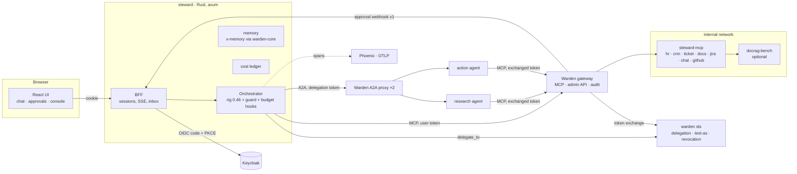
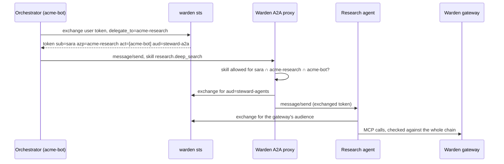

# Architecture

Steward is a company assistant built so that **the model is never the security boundary**.
Every tool call, document page, memory access and sub-agent call is an action that
[Warden](https://github.com/byQuexo/warden) authorizes for *this user, through this agent
chain, with these arguments*. The assistant only ever holds the user's own token; upstream
systems only ever see tokens exchanged for them.

## Components

| Crate / dir | Role |
|---|---|
| `steward-config` | Loads and validates a profile; generates the Warden catalog and gateway upstreams from `connectors/`. |
| `steward-mcp-servers` | `steward-mcp`: the built-in MCP servers over seed data. Verifies the exchanged token; the docs server cuts results to the caller's `doc_scope`. |
| `steward-agents` | One chat turn on rig: per-session MCP via `rig-rmcp` with the user's token, the guard hook (second line), budgets, the scripted model, chat events. |
| `steward-identity` | OIDC (code + PKCE, state, nonce), sessions, the directory (Keycloak admin API or seed users), token service client (test-as, delegation, revocation). |
| `steward-memory` | Facts per user and team in SQLite; every access a Warden action; PII refused by checksum. |
| `steward-cost` | Ledger, budget hook, OpenInference spans. |
| `steward-a2a` | The sub-agents as A2A servers (agent card from the profile, `message/send`, `tasks/get`). |
| `steward` | The BFF, the approvals inbox, the console API, `demo`, `replay`, `serve`, `agent`, `a2a-proxy`, `profile`. |
| `seed/` | Deterministic synthetic data, PDFs, page images, Keycloak realm (Python, uv). |
| `eval/` | Quality eval: rubric, LLM judge, kappa, bootstrap CIs, gates (Python, uv). |
| `ui/` | React + Vite + Tailwind + shadcn/ui. |
| `profiles/` | `acme` (German HR/CRM/IT company) and `devteam` (English software company). |

## A chat turn

1. The browser posts the message; the BFF looks up the server-side session (tokens never reach
   the browser) and verifies the token locally.
2. The orchestrator opens an MCP session with the **Warden gateway** using the user's token.
   `tools/list` is already filtered: Hanna never sees `hr.get_salary`.
3. Model, preamble (profile prompt, user context, remembered facts), tools and two hooks:
   * **Guard hook** (second line): checks each call in process with the same policy. A denial
     never leaves the process; `require_approval` is passed on, because the gateway owns
     approvals. Calls to tools the user is not offered (typically provoked by prompt injection)
     are answered as denied and the run continues.
   * **Budget hook**: books every model response in the ledger and stops the run before the
     next model call when the run, the user's day or the team's month is over budget.
4. The gateway decides again (with the live kill switch), exchanges the user's token at
   `warden sts` for one scoped to the upstream (`steward-mcp`), forwards exactly the checked
   arguments, and audits the decision in a hash chain.
5. For approvals the gateway holds the call and posts the request to the inbox (webhook v1).
   The inbox routes it per `approvals.yaml`, pushes it live to the approvers, enforces
   four-eyes and no self-approval, and answers when they decide.
6. Every step is streamed to the browser as an event: decisions, tool results, citations,
   handoffs, memory, cost.

## Delegation (A2A)

The caller's token never travels. Each hop gets a token minted for it, with the same subject
and the delegation chain, so the gateway applies `user roles ∩ every agent's ceiling`.

## Identity in the two run modes

| | `steward demo` (one process) | compose (`make demo`) |
|---|---|---|
| Users log in | dev login: pick a seed user | Keycloak, OIDC code flow with PKCE |
| User tokens | issued by the in-process token service | Keycloak (RS256) |
| Delegation, test-as, revocation | in-process token service | `warden sts` (trusts Keycloak) |
| Revocation reaches the gateway | introspection, no cache | introspection at Keycloak and sts |
| Directory for the console | seed users | Keycloak admin API |
| A2A proxy | Warden library in process | `steward a2a-proxy` per agent |

The gateway, the policy, the MCP servers and the assistant code are the same in both.

## Where decisions are made

| Decision | Where | Why there |
|---|---|---|
| Which tools a user sees | gateway (`tools/list`) | the model cannot call what it cannot see |
| Every tool call | guard hook, then gateway | fail fast in process; the gateway is authoritative |
| Approval | gateway → inbox | one held call, exactly the approved arguments forwarded |
| Delegation edge | `warden sts` (`may_delegate_to`) | no token for a forbidden edge exists at all |
| A2A skill | Warden A2A proxy | per-caller agent cards, task ownership |
| Memory | warden-core in process (`x-memory`) | memory is not an MCP tool, but still policy |
| Page image | warden-core in process (`x-docs-page`) | a guessed URL is checked like a search |
| Budget | budget hook | before the next model call, not after the bill |

## Run modes of the model

`models.yaml` maps agent roles to `provider/model` routes (any provider rig knows). Without the
API key the profile's `fallback` applies; both shipped profiles fall back to **scripted**, a rig
model that replays the profile's demo scenarios. It goes through the same agent loop, hooks,
gateway, approvals and budgets, which is why every demo scenario is a deterministic end-to-end
test in CI.
