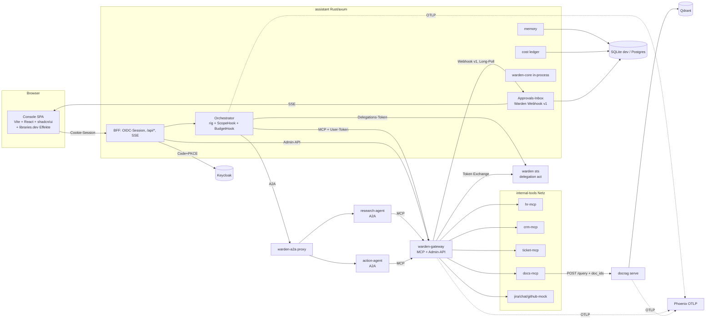

# Company Assistant: Bauplan (Rust + rig, Framework + Acme-Demo) — Rev. 2

> Nur Plan; entwickelt in einem agentischen Entwicklungs-Workflow. Stand: 05.11.2026 (Rev. 2). Baut auf **Warden** (`github.com/byQuexo/warden`, ehemals Arbeitsname `agent-scope`) auf, das inzwischen gebaut, getestet und öffentlich ist.
> Markierung: **[Annahme]** = nicht verifiziert, im genannten Spike prüfen. **[Verifiziert]** = nachgeschaut (Datum dabei). **[Warden]** = existiert bereits in Warden und wird nur genutzt.

---

## 0. Änderungen gegenüber Rev. 1

| # | Änderung | Warum |
|---|---|---|
| 1 | **agent-scope → Warden**, und fast alles, was der Bot von „agent-scope“ erwartete, ist jetzt da: Gateway, Admin-API, `warden-rig::ScopeHook`, `warden-a2a`-Proxy, STS mit `act`-Ketten, WASM-Paket, Webhook-Approver-Protokoll v1, Eval mit Mutation-Gate, Keycloak-Realm `acme` mit denselben 7 Usern. | Phase 0 schrumpft, Risiken aus Rev. 1 (rmcp, Mini-STS, Approval im Gateway) sind erledigt oder haben jetzt einen getesteten Fallback. |
| 2 | **Framework zuerst, Acme ist nur ein Profil.** Kein Crate heißt `acme-*`; Acme liegt unter `profiles/acme/` (Config, Seed-Parameter, Policy, Szenarien, Dokumente). Ein zweites Mini-Profil (`profiles/devteam/`) beweist die Austauschbarkeit. | Tims Anforderung „generisch, drop-in“. Gleiches Prinzip wie Warden `examples/devtools` vs. `examples/acme`. |
| 3 | **Warden-Lücken als eigene, kleine Warden-PRs in Phase 0/1** statt Workarounds im Bot: Health/Circuit-Breaker, OTLP-Export, Token-Introspection/Revocation, produktives `warden sts` mit Keycloak als Subject-Issuer, Impersonation/Dry-Run-Kontext. | Szenario 7 („Rolle entziehen → nächster Call deny“) braucht Introspection oder kurzlebige Tokens; Connector-Seite braucht Health; Phoenix braucht OTLP; „Als User testen“ braucht Dry-Run. Alles gehört fachlich in Warden. |
| 4 | **agent-approval-gate ist nicht mehr kritischer Pfad.** Gateway-Approvals laufen über Wardens Webhook-Protokoll v1 direkt in die Bot-Inbox (Long-Poll). approval-gate (`Gated`) nur für lokale Bot-Tools, Stufe 1, nach rig-0.46-Bump. | Rev. 1 machte Phase 0 von einem Fremd-Bump abhängig. Self-Approval-Verbot, Args-Bindung (`args_hash`), Re-Check und Timeout = deny macht Warden bereits. |
| 5 | **Approver-Routing im Bot** (`config/approvals.yaml`: Regel → Approver-Rolle, `four_eyes`), nicht in der Warden-Policy. | Warden-Policy bleibt generisch; Routing ist Bot-UX. |
| 6 | **MCP-Client-Fallback:** wenn `rig-rmcp` keinen Bearer pro Session kann, wird `warden-mcp::McpClient` (getestet gegen das Gateway) als rig-`DynamicTool`-Adapter genutzt. | Spike-Risiko aus Rev. 1 hat jetzt einen fertigen Plan B. |
| 7 | **A2A über `warden-a2a`**: Research/Action-Agents bekommen ein schlankes A2A-Server-Modul (eigene axum-Schicht nach Warden-Konvention `metadata.skillId`), davor der `warden-a2a`-Proxy. `a2a-lf` nur, wenn der Spike zeigt, dass es ohne Reibung passt. | Gleiche Durchsetzungslogik wie MCP, bereits getestet (Skill-Filter, Task-Ownership). |
| 8 | **README im docrag-Stil** (Banner, Metrik-Streifen, „Try it“, „What makes it different“, Ergebnis-Tabellen mit CIs, Learnings, ausklappbare Details) und **keine Co-Authored-By-Zeilen** in Commits/PRs. | Tims Vorgaben. |
| 9 | Aufwand neu: **~16 Tage** statt 17½ + 9 (Warden steht), plus ~2½ Tage Warden-PRs. | Siehe §11. |

---

## 1. Ziel

Ein **wiederverwendbares Framework für Firmen-Assistenten** (Rust, rig), gezeigt am fiktiven Profil **Acme GmbH**: ein Agent, dem eine Firma Zugriff auf HR, CRM, Tickets und Dokumente geben würde.

- **Rechte stimmen:** Hanna (HR) sieht keine Deals, Sven (Sales) keine Gehälter. Durchgesetzt von **Warden**, nicht vom Prompt.
- **Schreibzugriffe mit Freigabe:** Warden hält den Call, die Approvals-Inbox im Bot entscheidet (Long-Poll, Webhook v1).
- **Antworten mit Belegen:** Dokumentenfragen über `docrag-bench` mit verifizierten Zitaten und Seitenbild.
- **Betreibbar:** Admin-Console mit effektiven Rechten (+ „Was wäre wenn“ per Warden-WASM), „Als User testen“ (Dry-Run), Audit mit Verify-Status, Kosten pro User/Team/Agent, Kill-Switch, Connector-Health.
- **Gemessen:** Security-Gates (Warden-Eval + Profil-Szenarien) und Qualitäts-Eval (LLM-as-Judge, kalibriert, Bootstrap-CIs) in CI.
- **Framework, nicht nur Demo:** Profil austauschbar (`profiles/<name>/`), zweites Mini-Profil beweist es.

Sprache des Bots und der UI im Acme-Profil: Deutsch (Profil-Einstellung `locale: de`). Code, Identifier, Commits: Englisch.

## 2. Nicht im Scope

| Nicht drin | Warum |
|---|---|
| Echte Firmendaten, Produktivbetrieb, HA | Portfolio-Framework mit synthetischen Daten |
| Eigene RBAC-Logik im Bot | Liegt komplett in Warden. Bot ruft Gateway/Core/Admin-API. |
| Eigener RAG-Stack | docrag-bench bleibt der RAG-Dienst |
| Voice, Mobile, Fine-Tuning | Später bzw. nicht nötig |
| Echte Jira/Teams/Slack als Pflicht | Mocks aus Seed-Daten; Live-Connectoren optional per Token |
| Honcho als Pflicht | Optionaler `MemoryStore`-Adapter, Später |
| Durable Approvals über Neustarts | Später (rig `AgentRun` serialisieren) |

## 3. Was von Tims Repos genutzt wird

| Repo | Stand | Rolle im Bot | Nötige Änderung |
|---|---|---|---|
| **warden** | gebaut, CI grün, öffentlich **[Verifiziert 05.11.2026]**: Core, Gateway, Admin-API (`/v1/explain`, `/v1/effective`, `/v1/kill`, `/v1/audit/tail`, `/v1/upstreams`, `/v1/policy`), STS (`delegate_to` → `act`), `warden-rig::ScopeHook`, `warden-a2a`, WASM/npm `warden`, `warden eval/bench/catalog`, Keycloak-Realm `acme` | Gateway vor allen MCP-Tools; Core in-process für A2A/Memory/Explain; `ScopeHook` als 2. Linie; WASM für „Was wäre wenn“; Eval-Gates | **Warden-PRs W1–W5** (§11, Phase 0/1): Health/Circuit-Breaker, OTLP-Sink, Introspection + Revocation, `warden sts` produktiv mit externem Subject-Issuer, Impersonation/Dry-Run |
| **docrag-bench** | FastAPI `docrag serve`, Qdrant, Rerank, Abstain, verifizierte Zitate, OCR, Budget, OTEL, Judge/κ **[Verifiziert 04.11.2026]** | Dokumenten-Dienst hinter `docs-mcp`; Judge/κ/Bootstrap für Qualitäts-Eval | Keine Pflicht. Kein Auth in der API → nur internes Netz; `doc_ids`-Filter als ACL-Hebel |
| **agent-approval-gate** | Rust-Crate auf rig-core 0.40 **[Verifiziert 04.11.2026]** | Optional, Stufe 1: `Gated` für lokale Bot-Tools | rig-0.46-Bump als eigener PR, nicht kritischer Pfad |
| **rig** | 0.46.0 **[Verifiziert 31.10.2026]**; `rig-agent` 0.46 Hook-API (`on_dispatch`, `DispatchAction`) **[Verifiziert, in Warden genutzt]** | Agent-Runtime | Exakt pinnen (`=0.46.x`), MSRV 1.97 |

## 4. Architektur



**Grundregel:** Der Bot spricht **nie** direkt mit einem Upstream-MCP-Server. Compose-Netz `internal-tools` enthält nur Gateway + Upstreams + docrag; CI-Test beweist, dass ein Call aus dem Bot-Container fehlschlägt.

## 5. Repo- und Crate-Layout

Repo-Name **[Tims Wahl]**, Vorschlag: ein neutraler Produktname (z. B. `atrium`), Acme nur als Profil.

```
<repo>/
├── Cargo.toml                    # Workspace; rig = "=0.46.x"; warden-* als Git-Dependency (Tag) auf byQuexo/warden
├── crates/
│   ├── assistant/                # Binary: axum-BFF, /api/*, SSE, Inbox, statische UI
│   ├── assistant-agents/         # rig-Agents (orchestrator, research, action), Preambles aus Profil
│   ├── assistant-a2a/            # A2A-Server-Schicht (warden-Konvention), Agent Cards aus Catalog
│   ├── assistant-memory/         # MemoryStore-Trait, SQLite(+sqlite-vec)/Postgres, PII-Maskierung, Retention
│   ├── assistant-cost/           # pricing/budgets, Ledger, BudgetHook, OTEL-Attribute
│   ├── assistant-identity/       # OIDC-Session, Keycloak-Admin-Client, Test-as
│   ├── assistant-mcp-servers/    # ein Binary: hr | crm | ticket | docs | jira-mock | chat-mock | github-mock
│   └── assistant-config/         # Profil laden/validieren; erzeugt Warden-Catalog/Gateway-Upstreams aus connectors/*.yaml
├── profiles/
│   ├── acme/                     # Hauptdemo: profile.yaml, warden/{catalog,policy,identity,gateway}.yaml,
│   │                             # connectors/, approvals.yaml, docs_acl.yaml, seed.yaml, scenarios/, prompts/
│   └── devteam/                  # Mini-Profil (GitHub/Postgres/Slack wie Warden examples/devtools), beweist Austauschbarkeit
├── ui/                           # Vite + React + TS + Tailwind + shadcn/ui + libraries.dev
├── seed/                         # Python (uv): Faker de_DE, Kalibrierung, Ticket-Import, PDF-Erzeugung
├── eval/                         # Python (uv): Qualitäts-Eval, nutzt docrag-bench (Judge, κ, Bootstrap)
├── deploy/compose.yaml           # keycloak, warden-gateway, warden-sts, warden-a2a, assistant, agents, mcp-*, docrag, qdrant, phoenix
├── docs/ (architecture.md, demo-script.md, threat-model.md, DATA_LICENSES.md, profiles.md)
└── README.md                     # docrag-Stil
```

## 6. Schnittstellen

### 6.1 Bot ↔ Warden

```rust
// Pro Chat-Session: MCP zum Gateway mit dem User-Token aus der BFF-Session.
let tools = mcp_tools_for_session(&gateway_url, session.access_token()).await?; // rig-rmcp ODER warden-mcp-Adapter (Spike)
let agent = AgentBuilder::new(model)
    .preamble(&profile.preamble("orchestrator", &session.user))
    .tools(tools)                                                     // bereits vom Gateway gefiltert
    .hook(warden_rig::ScopeHook::new(engine.clone(), principal.clone()).with_prefix(""))   // 2. Linie [Warden]
    .hook(assistant_cost::BudgetHook::new(ledger.clone(), &session))
    .build();
```

- **[Annahme]** `rig-rmcp` 0.46 kann Bearer pro Verbindung über Streamable HTTP. Fallback **[Warden]**: `warden_mcp::McpClient` + kleiner `DynamicTool`-Adapter.
- In-process-Core für: A2A-Skill-Checks, Memory-Zugriff (`x-memory`-Aktionsart, `memory://user/{id}`, `memory://team/{team}`), Console-Explain.
- Admin-API **[Warden]**: `effective`, `explain`, `audit/tail`, `kill`, `upstreams`, `policy`.

### 6.2 Warden → Approvals-Inbox

Warden-Webhook-Protokoll v1 **[Warden]** (`POST`, HMAC-Signatur `X-Warden-Signature`, Felder `id, subject, agent, act, kind, name, args, args_hash, rule, reason, policy_version`). Die Inbox hält die Anfrage offen, bis ein Approver entscheidet oder `timeout_ms` (Default 120 s) abläuft, Antwort `{decision, approver, reason, args_hash}`.

- Routing in `profiles/<p>/approvals.yaml`: `rule → approvers: [role:sales-lead]`, `four_eyes: true`. Self-Approval lehnt Warden ohnehin ab.
- Gateway sendet Progress-Notifications an den Client **[Warden]**; der Bot mappt sie auf SSE `approval_pending`.

### 6.3 docs-mcp ↔ docrag-bench

Unverändert zu Rev. 1: `docs.search(question, doc_ids?)`, Team aus dem (exchangten) Token, `doc_ids = (doc_ids ∩ allowed) oder allowed`, `POST {DOCRAG}/query`. ACL doppelt (Warden-Regel `require: { arg: doc_ids … }` + docs-mcp schneidet). Seitenbild-Proxy im BFF mit erneuter ACL-Prüfung. `status: abstained` → „Dazu finde ich nichts Belegtes“. `cost_eur` → Ledger.

> **Warden-Kleinigkeit W6 (optional):** Constraint „Liste ⊆ Attribut-Liste“ (`subset_of: "{subject.attrs.doc_scope}"`) fehlt; bis dahin schneidet docs-mcp allein und Warden prüft nur `in` je Element über ein Wrapper-Tool.

### 6.4 Bot-API (für UI)

Wie Rev. 1 (`/api/chat` SSE mit `token, tool_call, decision, approval_pending, citation, agent_handoff, memory_used, cost, error, done`; `/api/approvals`; `/api/me`; `/api/admin/{users,effective,test-as,audit,kill}`; `/api/costs`; `/api/memory`), plus `GET /api/admin/connectors` (Health aus Warden W1).

## 7. Agents (rig)

| Agent | Keycloak-Client | Warden `agents.*.max` | Aufgabe |
|---|---|---|---|
| orchestrator | `acme-bot` | alles Lesende + delegieren an research/action | Chat, Routing, Antworten |
| research | `acme-research` | `docs:*`, `crm:read`, `ticket:read`, `research` | mehrere Quellen, nur lesend |
| action | `acme-action` | `crm:write`, `ticket:write`, `jira:write` | Schreibaktionen, immer mit Approval-Regeln |

- Modelle in `profiles/<p>/models.yaml`, Routing per `AgentHook::on_model_select`. Provider **[Tims Wahl]**.
- Preambles im Profil, kurz, ohne Rechte-Logik.
- Deterministische Bot-Tests mit `rig-cassette` **[Annahme: 0.46 API im Spike prüfen]**.

## 8. Daten und Seeding

Unverändert zu Rev. 1 (Quellen, Lizenzen, Seed-Pipeline, 7 Demo-User), mit drei Anpassungen:

- Seed-Parameter liegen im Profil (`profiles/acme/seed.yaml`), die Pipeline ist profilunabhängig.
- Keycloak-Realm wird aus dem Seed **erzeugt** und muss mit Wardens `examples/acme/keycloak/realm-acme.json`-Struktur kompatibel sein (User-Profile mit `org_unit`, `tenants`, Audience-Mapper) — dort bereits in CI mit echten Tokens bewiesen **[Warden]**.
- Kaggle-Lizenzen/Slugs vor dem Seed final prüfen **[Annahme aus Vorrecherche]**; keine CC-BY-NC-Daten.

## 9. Bausteine

### 9.1 Memory
Wie Rev. 1. Zugriff über Warden-Core mit eigener Aktionsart `x-memory` (Catalog: `memory.read_own`, `memory.read_team`, `memory.write`), Regeln `require: { arg: owner, equals: "{subject.id}" }` bzw. `in: "{subject.attrs.teams}"` — damit landen Memory-Checks auch in `warden eval`.

### 9.2 Connectors
Wie Rev. 1; `assistant-config` generiert Warden-`upstreams:` **und** Catalog-Skelett; `warden catalog pull/diff/accept` **[Warden]** pinnt die Definitionen. Health/Circuit-Breaker aus **W1**.

### 9.3 Cost und Phoenix
Wie Rev. 1. Warden-Audit-Events gehen per **W2 (OTLP-Sink)** an Phoenix, Attribute `warden.effect|rule|subject|agent|policy_version`. Ledger bleibt Quelle der Wahrheit.

### 9.4 A2A
- Orchestrator holt Delegations-Token bei **`warden sts`** (`delegate_to`, `act`-Kette) **[Warden, W4 macht Keycloak zum Subject-Issuer]**.
- `warden-a2a`-Proxy vor research/action: Agent Card pro Aufrufer gefiltert, Skill-Check, Task-Ownership **[Warden]**.
- `require_approval` bei action → A2A-Task `input-required` mit Approval-Link; UI zeigt beides in einer Karte.

### 9.5 Eval
| Ebene | Wo | Wann | Inhalt |
|---|---|---|---|
| Security | `warden eval --generate --mutate --coverage --gate` auf `profiles/acme/warden/` + `profiles/acme/scenarios/` | jeder PR | Warden-Basisszenarien + ≥ 15 Acme-spezifische (Gehalt, Tenant, Docs-ACL, Memory fremder User, A2A-Eskalation, Test-as-Write) |
| Bot-Flows (Replay) | `cargo test` + rig-cassette | jeder PR | 15 Gespräche, Tool-Calls + Entscheidungen exakt |
| Qualität | `eval/` (Python, docrag Judge/Stats) | nightly + manuell | ~80 Fragen über 7 User, `answer`/`abstain`/`deny` |

Rubrik und harte Gates wie Rev. 1 (`scope_violation`, `pii_leak`, `unapproved_write`, `unverified_citation`, `delegation_escalation` = 0). Kriterien mit κ < 0,4 nur berichten.

## 10. UI

Wie Rev. 1 (libraries.dev nur als Effekte: `thinking-orbs`, `bot-avatars`, `border-beam`; Basis Vite + React + shadcn/ui; Seiten Chat, Approvals, Effektive Rechte, Als User testen, User & Rollen, Audit, Kosten, Connectors, Mein Memory). Ergänzungen:

- **„Was wäre wenn“** rechnet mit dem npm-Paket `warden` (WASM) im Browser **[Warden]**.
- **„Als User testen“** nutzt **W5**: `warden sts` stellt ein Token mit `act=[admin]` und Claim `warden_impersonation: true` aus; das Gateway setzt `context.impersonation` und die Profil-Policy hat `deny_if: { context: impersonation, equals: true }` auf `sensitivity: write`.
- libraries.dev-Paketversionen beim Bau neu prüfen **[Annahme, Stand 04.11.2026]**; `prefers-reduced-motion` respektieren.

## 11. Phasen

| Phase | Inhalt | Tage | Abnahme |
|---|---|---|---|
| 0 | Workspace, Compose-Gerüst, CI; Spikes: `rig-rmcp` gegen Warden-Gateway (sonst `warden-mcp`-Adapter), A2A-Server-Schicht, `rig-cassette`; **Warden W4** (`warden sts` mit Keycloak als Subject-Issuer) | 1½ | `docker compose up`: Keycloak + Gateway + STS + leerer Bot; `docs/spikes.md`; Warden-PR W4 grün |
| 1 | Seed-Pipeline (org, hr, crm, tickets, work, docs, keycloak, checks), Profil-Struktur, Lizenzen; **Warden W1** (Health/Circuit-Breaker) | 2 | Seed deterministisch (gleicher Hash), `seed/report.md`, `DATA_LICENSES.md`; W1-PR mit E2E-Test |
| 2 | MCP-Server hr, crm, ticket, docs (docrag-Wrapper); Profil-Catalog/Policy; `warden catalog pull`; docrag ingest | 1½ | MCP Inspector über Gateway: Hanna kein `hr.get_salary`; `docs.search` nur Team-Dokumente; `warden eval` Acme-Profil grün inkl. Mutation |
| 3 | Bot-Kern: BFF + OIDC, Orchestrator, MCP pro Session, SSE-Chat, `ScopeHook`, Inbox (Webhook v1, Long-Poll, Routing) | 1½ | Sven-Deal 80 k → `approval_pending` → Sara gibt frei → ausgeführt; 5 Replay-Tests grün |
| 4 | RAG im Chat: Zitate, Seitenbild-Proxy mit ACL, Abstain, einfacher doc_ids-Router | ½ | Ivo-VPN-Frage (Scan-PDF) mit verifiziertem Zitat + Seitenbild; Sven bekommt kein HR-Seitenbild per URL |
| 5 | UI: Chat + Approvals, libraries.dev-Akzente, Reduced Motion | 2 | Szenarien 1–4 im Browser; Lighthouse-A11y ≥ 90 |
| 6 | Console: Effektive Rechte + WASM-What-if, Als User testen (**Warden W5**), User & Rollen, Audit, Kill-Switch; **Warden W3** (Introspection/Revocation) | 2 | Rolle entziehen → nächster Call deny ohne Token-Ablauf (W3); Test-as erzeugt `impersonation`-Audit, kein Write möglich |
| 7 | Memory (`x-memory` über Warden-Core) | 1½ | Fact gemerkt und genutzt; IBAN nie gespeichert; Hanna liest Svens Memory nicht (Warden-Szenario) |
| 8 | Cost + Phoenix; **Warden W2** (OTLP-Sink) | 1 | Budget stoppt Run; Kosten-Seite = Ledger-Summe; Warden-Entscheidungen in Phoenix filterbar |
| 9 | A2A: research + action, `warden-a2a`, Delegations-Tokens, `input-required` ↔ Approval, Handoff-Streaming | 1 | Szenario 6; Audit zeigt `act`-Kette; research → write-Skill deny |
| 10 | Connectors: Presets + Generator, Mocks, Connector-Seite mit Health | 1 | Mock stoppen → Tools verschwinden, Console zeigt `circuit open` |
| 11 | Qualitäts-Eval: ~80 Fragen, Rubrik, 50 Labels/κ, Gates, Baseline, nightly | 1½ | `uv run assistant-eval --gate` mit CIs; eingebauter PII-Leak macht CI rot |
| 12 | Zweites Profil `devteam`, README (docrag-Stil), Architekturdoku, Demo-Skript, Video-Skript | 1 | `make demo PROFILE=acme` und `PROFILE=devteam` laufen; frischer Clone → 10 Szenarien in < 20 min |

**Summe: ~18 Tage**, davon ~2½ Tage Warden-PRs (W1–W5), die Warden selbst verbessern.

## 12. Demo-Szenarien

Wie Rev. 1 (1 Hanna Gehalt · 2 Henrik eigene/fremde Abteilung · 3 Sven → Sara Approval · 4 Ivo Scan-PDF mit Zitat · 5 Ivo Injection-Ticket · 6 Sara A2A Research → Action · 7 Ines Console/Test-as/Rolle entziehen · 8 Fiona Kosten/Budget · 9 Sven Memory/forget · 10 Ines Kill-Switch), plus **11 devteam-Profil**: dieselbe Bot-Binary mit anderem Profil, ohne Codeänderung.

## 13. Definition of Done

- [ ] `make demo` startet alles; Seed deterministisch; 7 User loggen sich ein.
- [ ] Bot erreicht Upstreams nur über das Gateway (Netzwerk-Test in CI).
- [ ] Alle Szenarien in `docs/demo-script.md`, deterministische als Replay-Test.
- [ ] Security-Gates 0 (`warden eval` inkl. Mutation/Coverage), Qualitäts-Report mit CIs und κ eingecheckt.
- [ ] Jede Dokumentantwort hat verifizierte Zitate oder abstained.
- [ ] Kosten pro User/Team/Agent nachvollziehbar, Budget greift.
- [ ] Zweites Profil läuft ohne Codeänderung.
- [ ] Warden-PRs W1–W5 in Warden gemergt, mit Tests und Doku.
- [ ] Datenlizenzen vollständig, keine CC-BY-NC-Daten.
- [ ] README im docrag-Stil mit echten Zahlen; keine Co-Authored-By-Zeilen in der Historie.
- [ ] Kein Publish/Deploy ohne Tims Freigabe (GitHub-Repo öffentlich nur auf Tims Wunsch).

**Später:** durable Approvals, Honcho-Memory, Voice, Qdrant-ACL-Payload-Filter in docrag, gehostete Demo, weitere Live-Connectoren, Postgres als Default, approval-gate `Gated` für lokale Tools.

## 14. Trim & Showcase

**Nicht verhandelbar:** alle Tool-Zugriffe über das Warden-Gateway, fail-closed; Approvals im Gateway; Security-Gates mit 0-Toleranz; verifizierte Zitate; saubere Datenlizenzen; Profil austauschbar.

- **Stufe 0 (~9 Tage):** Phase 0, 1 (ohne work/Mocks), 2, 3, 4, 5, 6 (ohne User-Editieren), 11 (nur Gates + 30-Fragen-Smoke), 12 (README kurz, ohne zweites Profil).
- **Stufe 1 (+5 Tage):** Memory, Cost/Phoenix (W2), volle Qualitäts-Eval, W3 Introspection.
- **Stufe 2 (+4 Tage):** A2A, Connectors (W1), User-Editieren, zweites Profil.

## 15. Lern- und Portfolio-Winkel

Wie Rev. 1, mit Warden als eigenständigem, bereits öffentlichem Baustein: „Warden ist das Framework, der Assistent ist der Beweis, dass es in einem echten Produkt trägt.“ Drei eigene Repos greifen ineinander (warden, docrag-bench, optional agent-approval-gate), dazu Upstream-Chancen bei rig.

## 16. Annahmen und offene Fragen

| # | Punkt | Status / Vorschlag |
|---|---|---|
| 1 | `rig-rmcp` 0.46: Bearer pro Session über Streamable HTTP | **[Annahme]**, Spike Phase 0; Fallback `warden-mcp` **[Warden]** |
| 2 | `rig-cassette` 0.46 API | **[Annahme]**, Spike Phase 0 |
| 3 | Keycloak Token Exchange V2 ohne `act` | durch `warden sts` gelöst; W4 macht Keycloak-Tokens zum Subject |
| 4 | Introspection vs. kurze Token-TTL für Szenario 7 | W3 (RFC 7662 + 7009 im Warden-STS, Gateway-Modus `introspect: writes`) |
| 5 | Kaggle-Slugs/Lizenzen | vor Seed final prüfen, keine Rechtsberatung |
| 6 | LLM-Provider, Eval-Budget | Tims Wahl; Judge günstig (docrag nutzte DeepSeek V4.1 Flash) |
| 7 | Produktname/Repo-Name | Tims Wahl; Vorschlag neutral, Acme nur Profil |
| 8 | libraries.dev-Versionen | beim Bau prüfen |
